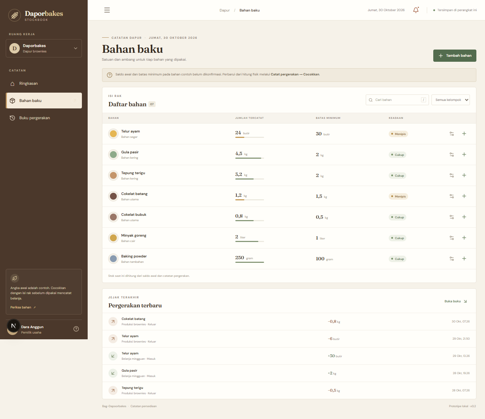
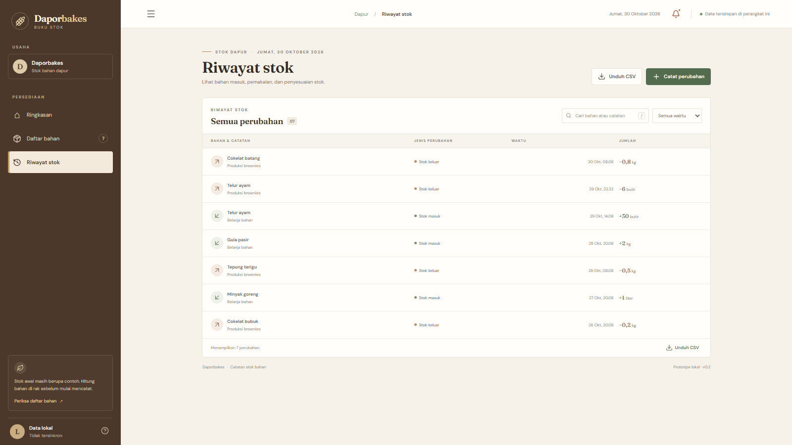

# Daporbakes: Catatan Stok Bahan

Daporbakes adalah prototipe untuk mencatat dan memantau bahan baku usaha brownies. Pengguna dapat mengelola daftar bahan, mencatat pergerakan stok, melihat bahan yang perlu diperiksa, dan meninjau riwayat perubahan.

## Status Sprint 4

Sprint 4 berlangsung pada 16–20 November 2026 dengan fokus validasi akhir, perbaikan prioritas, dan persiapan demonstrasi. Baseline MVP diselesaikan pada Sprint 3; paket penutupan dokumentasinya selesai pada 14 November. Per 18 November, Sprint 4 masih berjalan dan belum ditutup.

Perbaikan aplikasi pada tahap ini mencakup notifikasi aktivitas pada ikon lonceng, navigasi bawah pada layar kecil, dan penghapusan bahan dengan konfirmasi. Saat bahan dihapus, catatan riwayat stok yang terkait juga dihapus.

Dokumen [Monitoring & Controlling](docs/sprint-04/MONITORING_CONTROLLING.md) mencatat jadwal, effort, biaya, isu, dan rencana pengendalian berdasarkan data sampai penutupan Sprint 3.

## Fitur aplikasi

- Ringkasan jumlah bahan dan penanda stok yang sama dengan atau di bawah batas minimum.
- Tambah, ubah, cari, saring, dan hapus bahan.
- Catat stok masuk, stok keluar, dan penyesuaian berdasarkan hasil hitung fisik.
- Lihat pemberitahuan aktivitas setelah stok atau daftar bahan diubah. Pemberitahuan dan data tersimpan di browser pada perangkat yang sedang digunakan.
- Cari dan saring riwayat berdasarkan teks dan periode, lalu unduh hasil yang tampil sebagai CSV.
- Navigasi samping pada desktop dan bilah navigasi bawah pada ponsel.

## Menjalankan aplikasi

Kami memakai Node.js 20.9 atau lebih baru. Dari folder `app`, jalankan:

~~~bash
npm ci
npm run dev
~~~

Buka http://localhost:3000. Untuk memeriksa lint dan build produksi:

~~~bash
npm run lint
npm run build
npm start
~~~

Hentikan server lokal dengan Ctrl+C. Panduan aplikasi dan alur penggunaan tersedia pada [app/README.md](app/README.md). Checklist QA dan tinjauan UI Sprint 3 tersedia pada [app/QA_CHECKLIST.md](app/QA_CHECKLIST.md) dan [app/UI_REVIEW.md](app/UI_REVIEW.md).

## Tampilan aplikasi

Gambar berikut adalah cuplikan baseline Sprint 3; perbaikan Sprint 4 disebutkan pada bagian status di atas.

### Ringkasan

### Daftar bahan

### Riwayat stok

## Dokumen proyek

- [Sprint Tracker](docs/SPRINT_TRACKER.md)
- [Roadmap](PLANNING.md)
- [Project Backlog](docs/PROJECT_BACKLOG.md)
- [Decision Log](docs/DECISION_LOG.md)
- [Laporan Sprint 3](docs/sprint-03/LAPORAN_PELAKSANAAN_SPRINT_3.md)
- [Monitoring & Controlling](docs/sprint-04/MONITORING_CONTROLLING.md)

## Batas prototipe

Aplikasi menyimpan data pada localStorage browser dan perangkat yang sedang digunakan. Data tidak tersinkron antarperangkat dan tidak memiliki akun, database bersama, atau backup cloud. Ekspor CSV memuat riwayat yang sedang tampil dan bukan backup lengkap aplikasi. Autentikasi, master pemasok, histori harga, dan rekomendasi pembelian otomatis tetap berada di backlog pengembangan lanjutan.

## Tim dan kontribusi Sprint 3

| Anggota | Hasil kerja |
|---|---|
| Lutfiah Naysilla Azzahra | Fondasi dan implementasi MVP inventaris |
| Dara Anggun Fransisca | Penyempurnaan UI responsif dan review aksesibilitas |
| Raisa Nurfaiza | Panduan, checklist QA, dan laporan |
