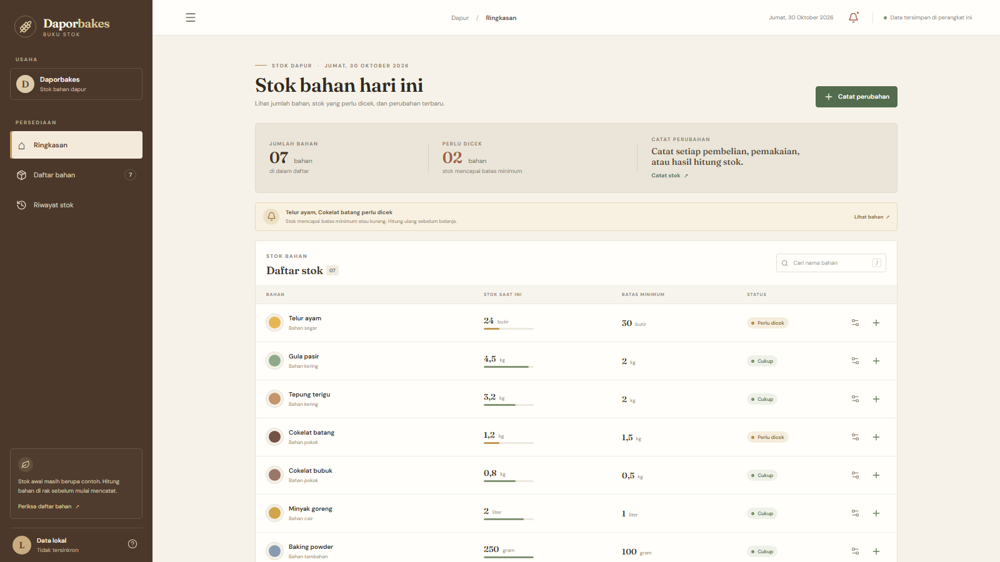
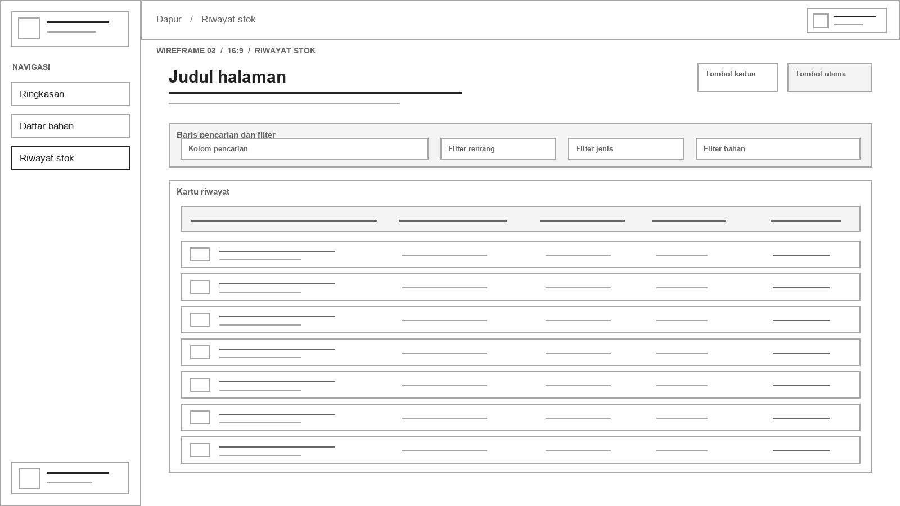

# Daporbakes — Catatan Stok Bahan

Kami mengembangkan prototipe stok bahan baku untuk usaha brownies Daporbakes. Aplikasi membantu pengguna melihat daftar bahan, mencatat pembelian dan pemakaian, menyesuaikan saldo setelah hitung fisik, serta menelusuri perubahan stok.

## Status Sprint 3

Kami telah menyelesaikan MVP lokal pada Sprint 3. Aplikasi menyimpan data pada browser/perangkat yang sedang digunakan dan memakai angka demo untuk bahan awal. Untuk simulasi operasional, pengguna memasukkan hasil hitung fisik melalui fitur Sesuaikan stok.

## Tampilan aplikasi

### Ringkasan

Kami menampilkan jumlah bahan, penanda stok minimum, daftar stok, dan perubahan terbaru. Tombol Catat perubahan membuka alur stok masuk, stok keluar, atau penyesuaian.

### Daftar bahan

Kami menampilkan satuan, saldo, batas minimum, dan status bahan. Pengguna dapat mencari, menyaring kelompok, menambah bahan, dan mengubah informasi bahan.

### Riwayat stok

Kami menampilkan bahan masuk, pemakaian, dan penyesuaian. Pengguna dapat mencari catatan, memilih periode, dan mengunduh baris yang tampil sebagai CSV.

### Wireframe

Kami menyertakan wireframe sederhana untuk tiga halaman inti. Setiap gambar berukuran 1600 × 900 piksel dengan rasio 16:9.

## Fitur MVP

- Ringkasan persediaan dan penanda bahan pada/bawah batas minimum.
- Tambah, ubah, cari, dan saring bahan, satuan, kelompok, saldo awal, serta batas minimum.
- Catat stok masuk, pemakaian, dan penyesuaian hitung fisik.
- Cari dan saring riwayat berdasarkan teks dan periode.
- Unduh CSV dari riwayat yang sedang tampil.
- Simpan data di localStorage browser.

## Menjalankan aplikasi

Kami memakai Node.js 20.9 atau lebih baru. Dari folder app, jalankan:

~~~bash
npm ci
npm run dev
~~~

Buka http://localhost:3000. Untuk memeriksa build produksi, jalankan:

~~~bash
npm run lint
npm run build
npm start
~~~

Panduan penggunaan dan batas penyimpanan tersedia pada [app/README.md](app/README.md). Hasil pemeriksaan manual ada pada [app/QA_CHECKLIST.md](app/QA_CHECKLIST.md).

## Tim dan kontribusi Sprint 3

| Anggota | Hasil kerja |
|---|---|
| Lutfiah Naysilla Azzahra | Fondasi dan implementasi MVP inventaris |
| Dara Anggun Fransisca | Penyempurnaan UI responsif dan review aksesibilitas |
| Raisa Nurfaiza | Panduan, checklist QA, dan laporan |

Kami mencatat bukti Pull Request, keputusan tim, effort, dan hasil QA pada [laporan Sprint 3](docs/sprint-03/LAPORAN_PELAKSANAAN_SPRINT_3.md). Roadmap dan status tiap deliverable tersedia pada [Sprint Tracker](docs/SPRINT_TRACKER.md) dan [roadmap](PLANNING.md).

## Batas prototipe

Kami menyimpan data pada browser dan perangkat yang sedang digunakan. Aplikasi Sprint 3 tidak menyediakan akun, database bersama, sinkronisasi antarperangkat, backup cloud, master pemasok, histori harga, atau rekomendasi belanja otomatis. CSV berisi perubahan stok yang sedang tampil dan bukan backup lengkap aplikasi.
