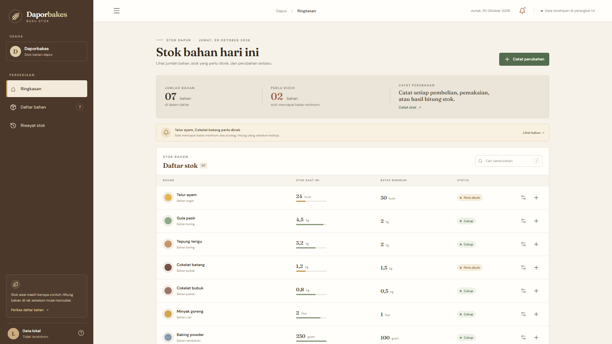
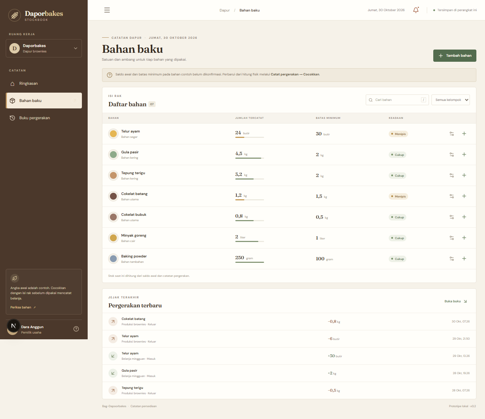
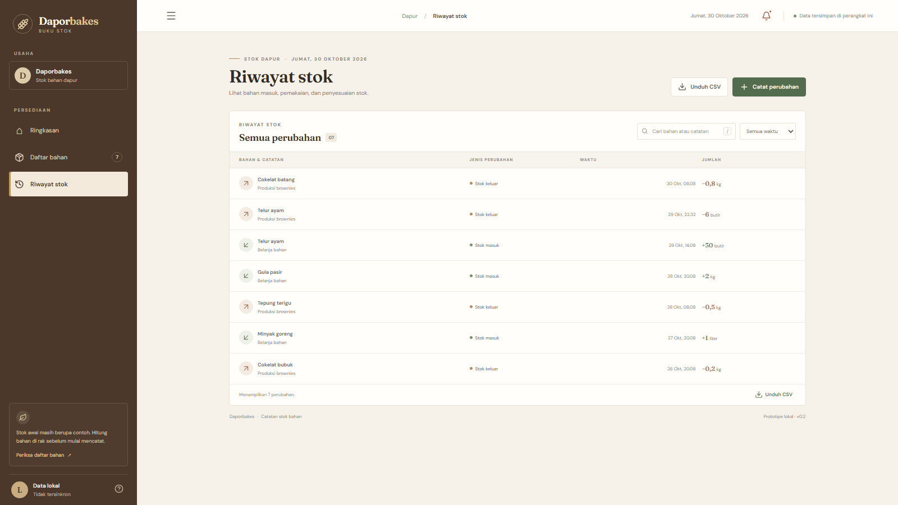
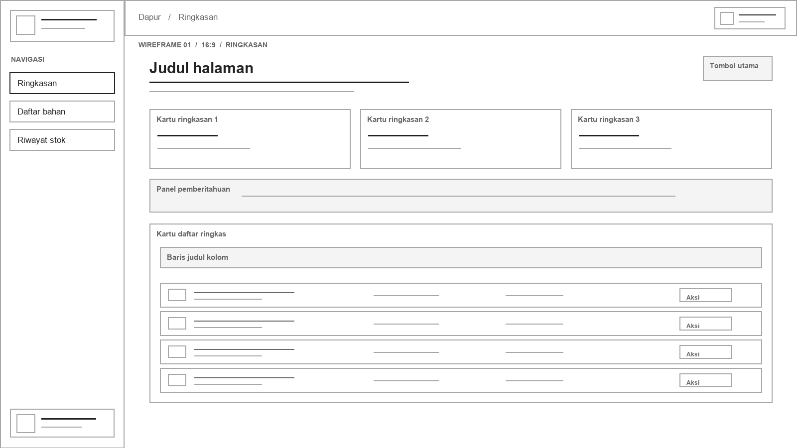
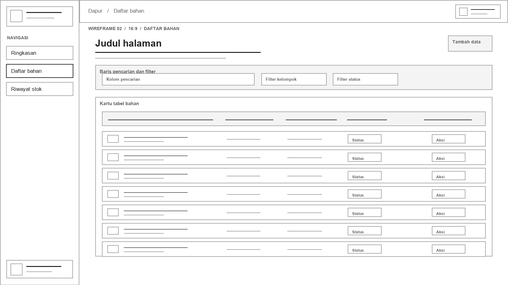
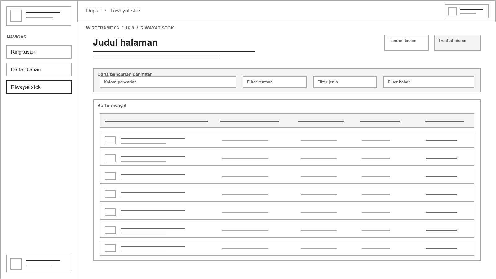

# Laporan Pelaksanaan Sprint 3
## Project Execution — Kelompok 6.1

| Informasi | Rincian |
|---|---|
| Proyek | Prototipe pencatatan persediaan bahan baku Daporbakes |
| Sprint | 3 dari 5 |
| Periode implementasi | 26–30 Oktober 2026 |
| Tanggal penutupan dokumentasi | 14 November 2026 |
| Mata kuliah | Manajemen Proyek Perangkat Lunak |
| Tim | Kelompok 6.1 |
| Lokasi studi kasus | Gampong Blang, Kota Langsa |

## Ringkasan eksekutif

Kami menyelesaikan MVP inventaris Daporbakes pada Sprint 3. Aplikasi memiliki halaman Ringkasan, Daftar bahan, dan Riwayat stok. Kami mengimplementasikan pengelolaan bahan, pencatatan stok masuk dan keluar, penyesuaian terhadap hitung fisik, penanda batas minimum, pencarian, filter periode, dan ekspor CSV. Kami menyelesaikan penyempurnaan UI responsif, panduan aplikasi, checklist QA, serta laporan sprint.

Kami menggabungkan pekerjaan melalui PR #11–#13. Pemeriksaan lint dan build lulus. Kami menyelesaikan seluruh skenario checklist QA pada build Sprint 3 dan menerima prototipe untuk demonstrasi. Kami menetapkan data layar sebagai data demo; alur operasional menggunakan daftar bahan, satuan, dan ambang yang telah tersedia pada prototipe.

## 1. Pendahuluan

Kami menyusun laporan ini untuk mencatat tujuan, hasil, pembagian kerja, usaha, pemeriksaan, keputusan, dan serah terima Sprint 3. Kami menyimpan bukti teknis dalam repository dan menautkan setiap kontribusi ke commit serta Pull Request.

### 1.1 Tim dan peran

| Anggota | Peran Sprint 3 |
|---|---|
| Dara Anggun Fransisca | Project Manager, UI/UX, dan koordinasi review |
| Lutfiah Naysilla Azzahra | Pengembangan aplikasi dan model data lokal |
| Raisa Nurfaiza | Dokumentasi aplikasi, QA, dan laporan pelaksanaan |

### 1.2 Sasaran Sprint 3

Kami menargetkan prototipe web lokal yang memperlihatkan alur inti pencatatan stok bahan baku, mudah ditinjau melalui layar ponsel, dan dilengkapi bukti penggunaan serta pemeriksaan.

## 2. Latar belakang

Daporbakes memproduksi brownies kukus dan panggang di Gampong Blang, Kota Langsa. Catatan survei menyebut produksi rata-rata 6–7 loyang per minggu, penjualan melalui pesanan online dan pre-order, serta pencatatan stok menggunakan buku tulis. Kami menggunakan konteks tersebut untuk merancang alur digital yang membantu pemilik meninjau persediaan dan perubahan bahan.

Kami membatasi MVP pada pencatatan stok dan demonstrasi antarmuka. Data contoh pada layar menjelaskan fungsi produk dan tidak menjadi angka stok operasional.

## 3. Ruang lingkup dan keputusan produk

### 3.1 Fitur yang kami selesaikan

| Area | Hasil |
|---|---|
| Ringkasan | Jumlah bahan, jumlah bahan pada/bawah minimum, daftar stok ringkas, dan perubahan terbaru |
| Daftar bahan | Tambah, cari, filter kelompok, ubah nama/satuan/kelompok/batas minimum |
| Pergerakan | Catat stok masuk, stok keluar, dan penyesuaian menggunakan jumlah hasil hitung fisik |
| Validasi | Catatan wajib, jumlah valid, serta penolakan stok keluar atau penyesuaian yang menghasilkan stok negatif |
| Riwayat | Pencarian bahan/catatan, periode semua waktu/7 hari/30 hari, dan ekspor CSV dari baris yang tampil |
| Responsif | Navigasi ponsel, fokus keyboard, target sentuh, dialog, notifikasi, dan safe area |

### 3.2 Keputusan yang kami gunakan

Kami memilih web responsif berbasis Next.js, React, dan TypeScript. Kami menyimpan data pada localStorage di browser dan perangkat yang digunakan. Kami menetapkan satu satuan tetap untuk setiap bahan, batas minimum yang dapat diubah per bahan, dan peringatan ketika saldo sama dengan atau di bawah batas tersebut.

Kami mencatat pembelian sebagai stok masuk, pemakaian sebagai stok keluar, serta hasil hitung fisik sebagai penyesuaian bersih. Kami menggunakan kolom catatan untuk menyebut pemasok atau alasan transaksi; pemasok menjadi teks catatan dan bukan entitas data terpisah pada MVP. Kami mencatat bahan rusak atau kedaluwarsa sebagai stok keluar dengan keterangan.

Kami memilih tujuh bahan contoh: telur ayam, gula pasir, tepung terigu, cokelat batang, cokelat bubuk, minyak goreng, dan baking powder. Kami memakai nilai bawaan yang tercantum di aplikasi untuk demonstrasi, lalu pengguna dapat mengubah stok dan batas minimum melalui antarmuka.

### 3.3 Batas produk yang kami sepakati

Kami menetapkan Sprint 3 sebagai prototipe satu pengguna dan satu browser. Produk tidak menyediakan akun, hak akses, database bersama, sinkronisasi antarperangkat, backup cloud, master pemasok, histori harga, tanggal kedaluwarsa terstruktur, atau rekomendasi belanja otomatis. CSV berisi pergerakan yang terlihat setelah filter dan bukan salinan lengkap data aplikasi.

## 4. Hasil implementasi

Kami membangun tiga halaman utama. Ringkasan membantu pengguna melihat bahan yang perlu diperiksa dan perubahan terbaru. Daftar bahan memperlihatkan satuan, saldo, batas minimum, status, serta tindakan pengelolaan. Riwayat stok memperlihatkan arah perubahan, tanggal, bahan, jumlah, dan catatan.

Alur yang kami sediakan adalah: **Ringkasan → Daftar bahan atau Catat perubahan → Simpan → Tinjau Riwayat stok**. Untuk penyesuaian, pengguna memasukkan angka hasil hitung fisik. Aplikasi menghitung selisih terhadap saldo tercatat dan menyimpan transaksi koreksi.

## 5. Pembagian tugas dan bukti pekerjaan

Kami menyelesaikan kontribusi melalui branch terpisah dan menggabungkannya melalui Pull Request.

| Anggota | Hasil kerja | Commit dan Pull Request |
|---|---|---|
| Lutfiah Naysilla Azzahra | Fondasi aplikasi, model data, pengelolaan bahan, pergerakan stok, ringkasan, riwayat, dan ekspor | [Commit a62bd1e](https://github.com/MPPL01022026/Kelompok-6.1/commit/a62bd1e), [PR #11](https://github.com/MPPL01022026/Kelompok-6.1/pull/11) |
| Dara Anggun Fransisca | Penyempurnaan UI responsif, navigasi ponsel, fokus, target sentuh, dan review UI | [Commit 1671b14](https://github.com/MPPL01022026/Kelompok-6.1/commit/1671b14), [PR #12](https://github.com/MPPL01022026/Kelompok-6.1/pull/12) |
| Raisa Nurfaiza | Panduan aplikasi, checklist QA, dan laporan Sprint 3 | [Commit 07f6f39](https://github.com/MPPL01022026/Kelompok-6.1/commit/07f6f39), [PR #13](https://github.com/MPPL01022026/Kelompok-6.1/pull/13) |

Ketiga Pull Request telah digabung ke main. Metadata Git mencatat seluruh kontribusi pada 30 Oktober 2026. Kami menggunakan waktu tersebut sebagai catatan integrasi, bukan sebagai ukuran durasi kerja.

## 6. Estimasi dan realisasi manday

Kami memakai 1 manday (MD) = 8 jam kerja efektif. Kami memperkirakan usaha berdasarkan deliverable lalu mencatat realisasi per anggota.

| Anggota | Estimasi | Realisasi | Jam realisasi | Rincian |
|---|---:|---:|---:|---|
| Lutfiah Naysilla Azzahra | 2,75 MD | 3,00 MD | 24 jam | Fondasi aplikasi, model data lokal, bahan, transaksi, ringkasan, riwayat, CSV |
| Dara Anggun Fransisca | 1,25 MD | 1,25 MD | 10 jam | Alur, tampilan responsif, navigasi, fokus keyboard, target sentuh, review |
| Raisa Nurfaiza | 1,00 MD | 1,25 MD | 10 jam | Panduan, checklist QA, laporan, pengelolaan bukti |
| **Total** | **5,00 MD** | **5,50 MD** | **44 jam** | |

Kami menyelesaikan 0,50 MD di atas estimasi awal. Tambahan usaha berasal dari perapian state inventaris, validasi alur koreksi, dan dokumentasi pemeriksaan.

## 7. Pemeriksaan dan hasil

Kami memeriksa source dengan lint dan build produksi; keduanya lulus pada tinjauan Sprint 3. Kami menjalankan QA manual pada 30 Oktober 2026 di Windows 11 dengan Chrome desktop dan emulasi layar ponsel 390 × 844 piksel.

| Kelompok skenario | Hasil |
|---|---|
| Tambah, cari, filter, ubah bahan, dan persistensi setelah muat ulang | Lulus |
| Stok masuk, stok keluar, stok tidak mencukupi, dan pesan validasi | Lulus |
| Penyesuaian hitung fisik lebih tinggi, lebih rendah, dan sama | Lulus |
| Status batas minimum, pencarian riwayat, serta filter semua waktu/7 hari/30 hari | Lulus |
| Kolom CSV, tanda jumlah, satuan, filter yang tampil, dan pengamanan formula | Lulus |
| Desktop, layar ponsel 390 px, navigasi keyboard, Escape, dialog, dan fokus | Lulus |

Kami mencatat rincian skenario dalam [Checklist QA](../../app/QA_CHECKLIST.md). Kami memakai emulasi layar sebagai standar pemeriksaan responsif Sprint 3.

## 8. Koordinasi dan keputusan tim

Kami mengadakan dua review internal dan mencatat hasilnya sebagai berikut.

| Tanggal dan waktu | Peserta | Pokok bahasan | Keputusan | Tindak lanjut |
|---|---|---|---|---|
| 29 Oktober 2026, 19.00 WIB | Dara, Lutfiah, Raisa | Cakupan MVP, data bahan contoh, aturan stok minimum, dan pembagian kerja | Kami menetapkan aplikasi web responsif lokal, satuan per bahan, catatan wajib, dan penyesuaian berdasarkan jumlah fisik | Lutfiah membangun alur; Dara meninjau UI; Raisa menyiapkan panduan/QA |
| 30 Oktober 2026, 19.30 WIB | Dara, Lutfiah, Raisa | Review hasil, pemeriksaan build, aksesibilitas, dan paket dokumentasi | Kami menerima MVP untuk demonstrasi; kami menggabungkan PR #11–#13 dan menutup Sprint 3 | Raisa menyelesaikan laporan dan checklist; seluruh tim menyetujui penutupan internal |

## 9. Tangkapan layar aplikasi

Angka pada tangkapan layar merupakan data demo yang sama dengan nilai awal pada prototipe.

### 9.1 Ringkasan

Kami menampilkan jumlah bahan, bahan di bawah batas minimum, daftar stok ringkas, dan perubahan terbaru.

### 9.2 Daftar bahan

Kami menampilkan kategori, satuan, saldo tercatat, batas minimum, status, dan tindakan untuk mengubah atau mencatat perubahan.

### 9.3 Riwayat stok

Kami menyediakan pencarian, filter waktu, arah perubahan, jumlah, catatan, dan ekspor CSV.

## 10. Wireframe dan alur

Kami memakai wireframe berikut untuk menunjukkan tata letak tiga halaman dengan rasio 16:9.

### 10.1 Ringkasan

### 10.2 Daftar bahan

### 10.3 Riwayat stok

## 11. Penutupan Sprint 3

Kami menyelesaikan semua deliverable Sprint 3: MVP lokal, UI responsif, panduan aplikasi, hasil QA, laporan, screenshot, dan wireframe. Kami menetapkan pengembangan akun, database bersama, backup terstruktur, master pemasok, histori harga, dan rekomendasi pembelian sebagai ruang lingkup sprint lanjutan.

## Referensi

Kami menggunakan artefak berikut untuk menjalankan, meninjau, dan menutup Sprint 3.

| Artefak | Kegunaan |
|---|---|
| [README proyek](../../README.md) | Ringkasan produk, tampilan, dan cara menjalankan |
| [Panduan aplikasi](../../app/README.md) | Alur kerja dan batas penyimpanan |
| [Checklist QA](../../app/QA_CHECKLIST.md) | Skenario serta hasil pemeriksaan |
| [Tinjauan UI](../../app/UI_REVIEW.md) | Perbaikan responsif dan aksesibilitas |
| [Sprint Tracker](../SPRINT_TRACKER.md) | Status deliverable dan keputusan review |
| [Pelaksanaan Sprint 3](SPRINT_EXECUTION.md) | Ringkasan hasil, effort, dan penerimaan |
