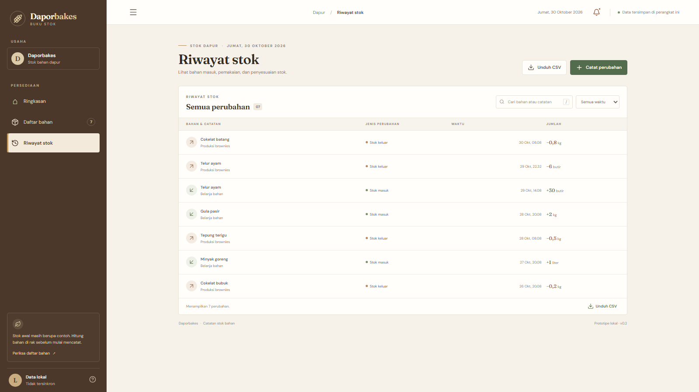
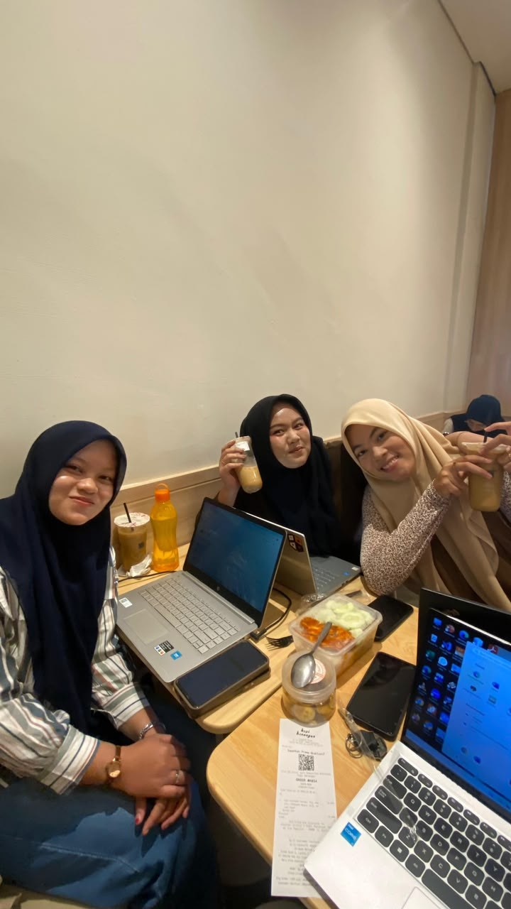
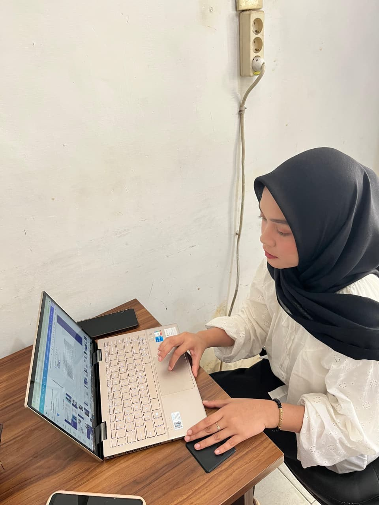
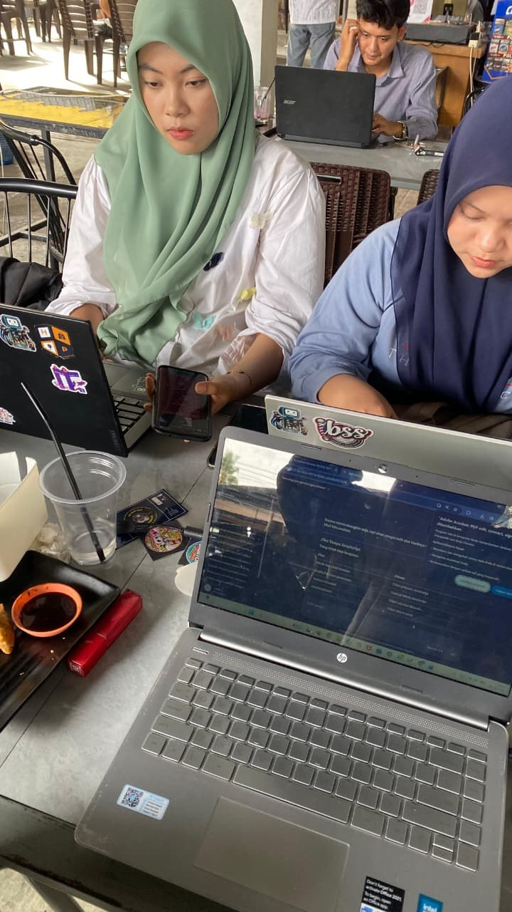
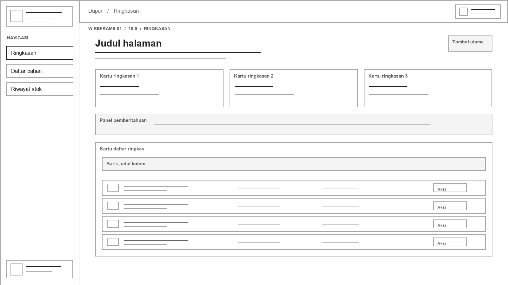
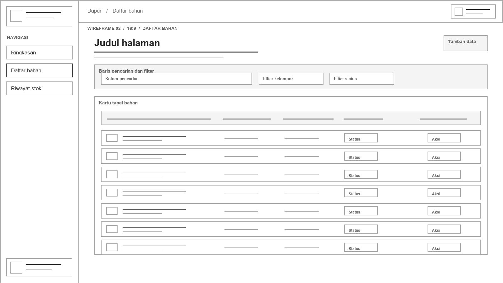
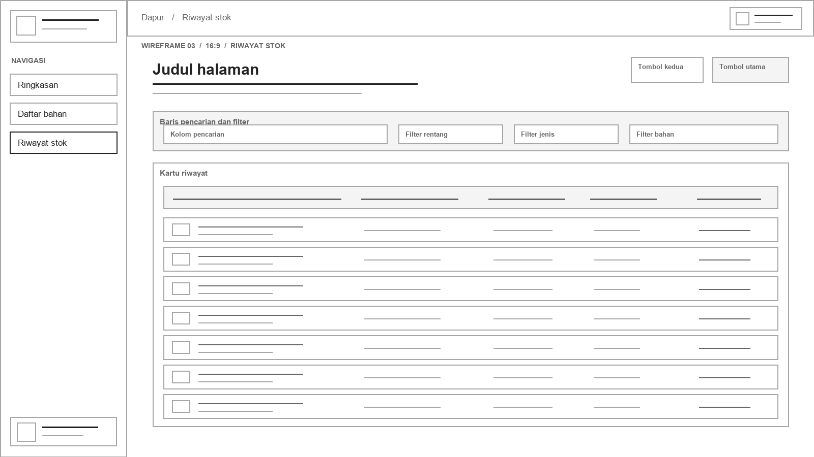

# Laporan Pelaksanaan Sprint 3

## Project Execution

| Informasi | Rincian |
|---|---|
| Proyek | Prototipe pencatatan persediaan bahan baku Daporbakes |
| Sprint | 3 dari 5 |
| Mata kuliah | Manajemen Proyek Perangkat Lunak |
| Tim | Kelompok 6.1 |
| Tanggal laporan | 30 Oktober 2026 |
| Lokasi studi kasus | Gampong Blang, Kota Langsa |

> Versi Markdown dari [Laporan Pelaksanaan Sprint 3 (PDF)](LAPORAN_PELAKSANAAN_SPRINT_3.pdf). Foto koordinasi dan wireframe disertakan pada bagian terkait.

## Ringkasan

MVP inventaris Daporbakes berjalan sebagai prototipe lokal dengan halaman Ringkasan, Daftar bahan, dan Riwayat stok. Bukti GitHub menunjukkan satu kontribusi pengembangan aplikasi, satu kontribusi antarmuka, dan satu kontribusi dokumentasi yang telah digabung ke `main` melalui Pull Request masing-masing.

Catatan tinjauan UI menyebut pemeriksaan lint dan build lulus. Checklist QA manual tersedia, tetapi belum berisi hasil sesi pengujian. Karena itu, laporan ini tidak menyatakan seluruh alur telah diuji. Angka di layar adalah data contoh dan perlu dicocokkan dengan stok fisik.

### Cara membaca bukti

- **Bukti GitHub** merujuk pada commit dan Pull Request yang dapat dibuka. Bukti tersebut mendukung pemilik kontribusi, berkas yang berubah, serta status integrasi.
- **Bukti repository** merujuk pada source code atau catatan pemeriksaan yang tersedia.
- **Foto dokumentasi** menunjukkan aktivitas berkumpul dan bekerja dengan laptop. Foto tidak memuat metadata tanggal, agenda, daftar hadir, atau keputusan rapat.
- Jika bukti tidak tersedia, laporan menyebutnya secara terbuka dan tidak memperkirakan detail yang hilang.

## Daftar isi

1. [Pendahuluan](#1-pendahuluan)
2. [Latar belakang](#2-latar-belakang)
3. [Tujuan pengembangan](#3-tujuan-pengembangan)
4. [Batasan dan ruang lingkup](#4-batasan-dan-ruang-lingkup)
5. [Pembagian tugas dan bukti pekerjaan](#5-pembagian-tugas-dan-bukti-pekerjaan)
6. [Alur dan wireframe prototipe](#6-alur-dan-wireframe-prototipe)
7. [Tampilan antarmuka aplikasi](#7-tampilan-antarmuka-aplikasi)
8. [Implementasi, pemeriksaan, dan tindak lanjut](#8-implementasi-pemeriksaan-dan-tindak-lanjut)
9. [Dokumentasi rapat dan koordinasi](#9-dokumentasi-rapat-dan-koordinasi)
10. [Lampiran wireframe 16:9](#10-lampiran-wireframe-169)

## 1. Pendahuluan

Laporan ini mencatat pekerjaan pengembangan MVP inventaris bahan baku Daporbakes pada Sprint 3. Dokumen menghubungkan pembagian peran, bukti GitHub, fungsi prototipe, dan status pemeriksaan agar hasil dapat ditinjau.

### 1.1 Tim pengembang

| Anggota | Fokus peran |
|---|---|
| Dara Anggun Fransisca | Project Manager dan UI/UX |
| Lutfiah Naysilla Azzahra | Pengembangan aplikasi |
| Raisa Nurfaiza | Dokumentasi, laporan, dan bukti survei |

### 1.2 Pelaksanaan

Bukti repository mencatat kontribusi pada 30 Oktober 2026. Waktu commit menunjukkan urutan penyimpanan perubahan, bukan durasi kerja.

### 1.3 Catatan jam kerja

Repository tidak memuat jam kerja per anggota. Laporan ini tidak memperkirakan durasi dari waktu commit.

## 2. Latar belakang

Daporbakes menjual brownies kukus dan panggang di Gampong Blang, Kota Langsa. Project Charter merangkum survei yang menyebut produksi sekitar 6–7 loyang per minggu, pesanan online dan pre-order, serta pencatatan stok dengan buku tulis. Pemilik perlu melihat jumlah bahan dan memperkirakan pembelian saat kebutuhan berubah.

Pencatatan digital dapat membantu pemilik meninjau stok dan perubahan bahan. MVP mendemonstrasikan alur pencatatan tersebut, tetapi nilai contoh belum mewakili stok usaha yang telah dikonfirmasi. Sumber konteks: [Project Charter Sprint 1](../sprint-01/PROJECT_CHARTER.md).

## 3. Tujuan pengembangan

Sprint 3 menghasilkan prototipe web lokal untuk mendemonstrasikan alur dasar inventaris dan menyediakan bukti pelaksanaan pekerjaan tim. Prototipe bertujuan untuk:

- Menampilkan ringkasan stok, bahan yang perlu diperiksa, dan pergerakan terbaru.
- Mengelola bahan, kelompok, satuan, saldo awal, dan batas minimum.
- Mencatat stok masuk, stok keluar, dan pencocokan dengan hitung fisik.
- Mencari serta menyaring riwayat, lalu mengunduh hasil yang terlihat sebagai CSV.

Tujuan ini menjelaskan cakupan prototipe. Persetujuan kebutuhan dari pemilik dan penggunaan untuk operasional belum dibuktikan di repository.

## 4. Batasan dan ruang lingkup

| Tercakup pada prototipe | Belum tersedia atau belum diverifikasi |
|---|---|
| Ringkasan bahan dan status terhadap batas minimum | Login, akun pengguna, dan hak akses |
| Tambah, cari, saring, dan ubah bahan | Database bersama, sinkronisasi antarperangkat, dan cadangan cloud |
| Pencatatan masuk, keluar, dan penyesuaian stok | Pemasok, transaksi pembelian, dan rekomendasi belanja otomatis |
| Riwayat, filter waktu, dan ekspor CSV dari hasil yang terlihat | Validasi angka contoh bersama pemilik usaha dan penggunaan operasional |

### Batasan penyimpanan

Aplikasi menyimpan data pada `localStorage` di browser pada perangkat yang sedang digunakan. Data tidak tersinkron ke perangkat lain. Ekspor CSV memuat catatan yang terlihat dan bukan cadangan lengkap daftar bahan. Sumber: [panduan aplikasi](../../app/README.md) dan source aplikasi.

## 5. Pembagian tugas dan bukti pekerjaan

Riwayat Git mencatat tiga kontribusi berurutan. Tanggal commit untuk seluruh baris adalah 30 Oktober 2026, zona waktu WIB.

| Waktu | Anggota | Perubahan | Bukti |
|---|---|---|---|
| 19:06:59 | Lutfiah Naysilla Azzahra | MVP inventaris dan fondasi aplikasi | [Commit `a62bd1e`](https://github.com/MPPL01022026/Kelompok-6.1/commit/a62bd1e), [PR #11](https://github.com/MPPL01022026/Kelompok-6.1/pull/11) |
| 19:15:23 | Dara Anggun Fransisca | Penyempurnaan UI responsif, navigasi, fokus, dan target sentuh | [Commit `1671b14`](https://github.com/MPPL01022026/Kelompok-6.1/commit/1671b14), [PR #12](https://github.com/MPPL01022026/Kelompok-6.1/pull/12) |
| 19:18:45 | Raisa Nurfaiza | Panduan aplikasi dan checklist QA manual | [Commit `07f6f39`](https://github.com/MPPL01022026/Kelompok-6.1/commit/07f6f39), [PR #13](https://github.com/MPPL01022026/Kelompok-6.1/pull/13) |

Ketiga PR berstatus merged ke `main`. Commit merge PR #13 pada basis laporan adalah `b8820c0`. Waktu mengikuti metadata commit Git; waktu tersebut menunjukkan penyimpanan perubahan, bukan jam kerja.

## 6. Alur dan wireframe prototipe

Alur dasar: **Ringkasan → Daftar bahan atau Catat stok → Simpan catatan → Tinjau Riwayat stok**.

Wireframe sederhana per halaman tersedia pada [Lampiran wireframe 16:9](#10-lampiran-wireframe-169). Wireframe tersebut merupakan rekonstruksi tata letak prototipe, bukan rancangan awal sebelum implementasi.

## 7. Tampilan antarmuka aplikasi

Angka dan catatan pada tangkapan layar adalah data contoh.

### 7.1 Ringkasan

Ringkasan menunjukkan jumlah bahan, stok yang perlu diperiksa, daftar singkat stok, dan perubahan terbaru. Tombol utama digunakan untuk mencatat perubahan stok.

### 7.2 Daftar bahan

Daftar bahan menampilkan informasi bahan, satuan, stok saat ini, batas minimum, dan status. Pengguna dapat mencari, menyaring, menambah, dan mengubah bahan.

### 7.3 Riwayat stok

Riwayat stok merangkum bahan masuk, pemakaian, dan penyesuaian setelah hitung fisik. Pengguna dapat mencari catatan, memilih rentang waktu, dan mengunduh hasil yang terlihat sebagai CSV.

Ketiga tangkapan layar berukuran 1600 × 900 piksel dengan rasio 16:9.

## 8. Implementasi, pemeriksaan, dan tindak lanjut

Source code menunjukkan prototipe menggunakan Next.js, React, TypeScript, dan `localStorage`. Aplikasi memuat tiga halaman utama, pengelolaan bahan dan pergerakan stok, filter riwayat, serta ekspor CSV.

| Pemeriksaan | Status bukti |
|---|---|
| `npm run lint` dan `npm run build` | Tercatat lulus pada [catatan tinjauan UI](../../app/UI_REVIEW.md) |
| QA manual | [Checklist QA](../../app/QA_CHECKLIST.md) tersedia, tetapi belum memuat hasil sesi uji |
| Ponsel dan aksesibilitas | Beberapa perbaikan dicatat; pemeriksaan perangkat nyata masih menjadi tindak lanjut |
| Data contoh | Belum dikonfirmasi dengan pemilik atau melalui hitung fisik |

### Tindak lanjut

1. Jalankan checklist QA pada build yang akan direview dan catat perangkat, browser, tanggal, hasil, serta bukti.
2. Uji tampilan dan navigasi keyboard pada ukuran ponsel serta perangkat nyata.
3. Konfirmasi stok awal dan batas minimum dengan pemilik Daporbakes sebelum menggunakan data untuk operasional.
4. Tentukan kebutuhan akun, penyimpanan bersama, dan pencadangan sebelum pengembangan lanjutan.

## 9. Dokumentasi rapat dan koordinasi

Foto yang diberikan untuk laporan ini menunjukkan anggota tim berkumpul menggunakan laptop, seseorang bekerja di laptop, dan kolaborasi beberapa orang dengan perangkat kerja. Foto menjadi dokumentasi visual aktivitas tim.

File foto tidak menyertakan metadata tanggal, agenda, daftar hadir, atau keputusan rapat. Karena itu, foto tidak menggantikan notulen dan laporan ini tidak menyimpulkan tanggal atau hasil rapat dari gambar saja. Repository juga tidak memuat catatan rapat Sprint 3 yang dapat diverifikasi.

### Foto 1. Diskusi tim

Diskusi tim di meja kerja dengan laptop.

### Foto 2. Aktivitas kerja

Seseorang menggunakan laptop saat bekerja.

### Foto 3. Kolaborasi

Kolaborasi beberapa orang dengan perangkat kerja.

## 10. Lampiran wireframe 16:9

Wireframe berikut menunjukkan posisi elemen, ukuran relatif kartu, tombol, filter, serta area teks. Wireframe dibuat sebagai sketsa tata letak tanpa detail visual final. Masing-masing berukuran 1600 × 900 piksel.

### Wireframe halaman Ringkasan

### Wireframe halaman Daftar bahan

### Wireframe halaman Riwayat stok

---

Dokumen pendukung: [Panduan aplikasi](../../app/README.md), [Checklist QA](../../app/QA_CHECKLIST.md), [Tinjauan UI](../../app/UI_REVIEW.md), [Rencana Sprint](../SPRINT_TRACKER.md), dan [Rencana peran serta tanggung jawab](../sprint-02/RESOURCE_RESPONSIBILITY_PLAN.md).
