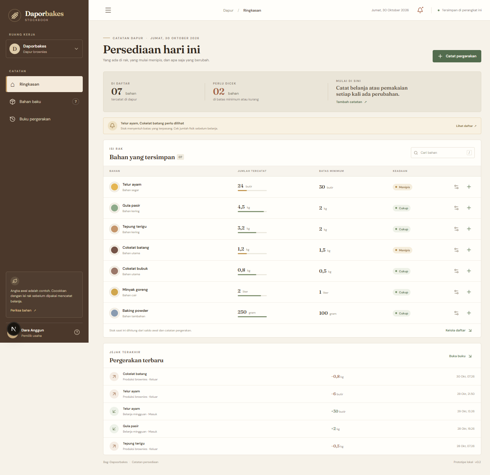
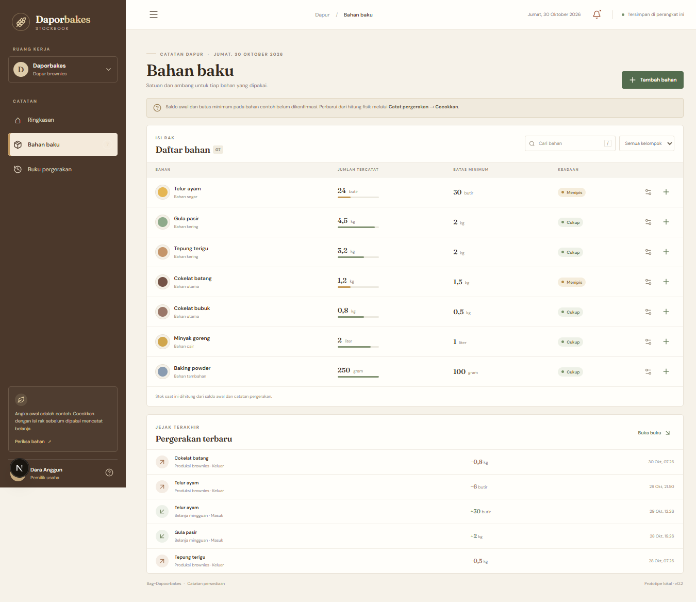
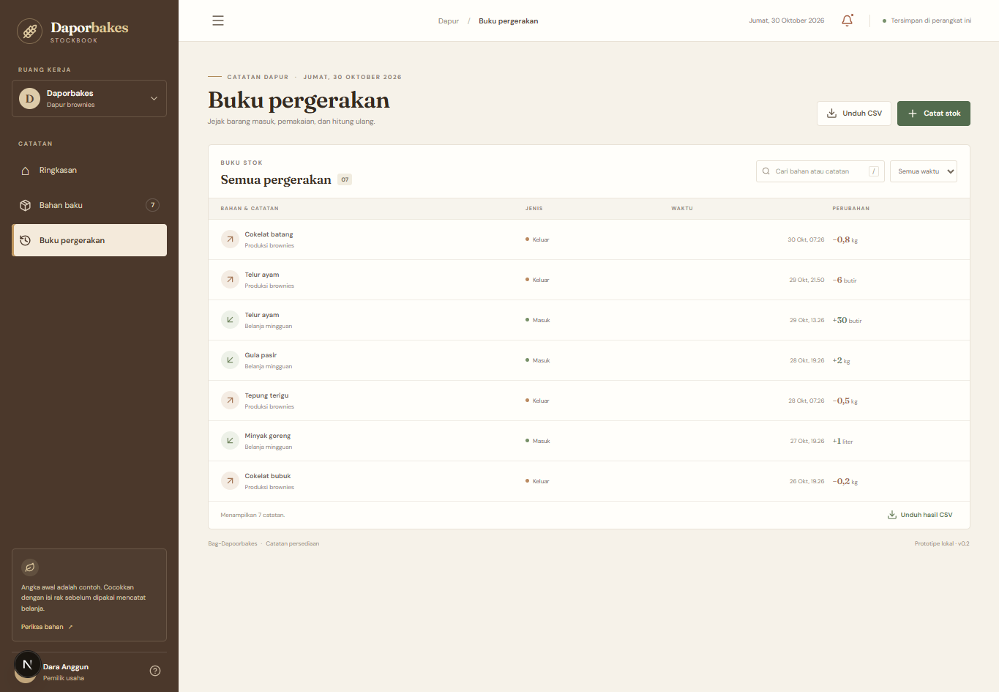

# Bukti Pelaksanaan Sprint 3 — Project Execution

Dokumen ini merangkum bukti pekerjaan pengembangan yang tersedia di repository pada 30 Oktober 2026. Sprint 3 berfokus pada pembuatan MVP dan penyempurnaan pengalaman penggunaan. Catatan berikut merujuk pada riwayat GitHub dan dokumen proyek; ini bukan notulen rapat.

## Pembagian tugas dan hasil

| Anggota | Pekerjaan | Bukti commit | Pull request |
|---|---|---|---|
| Lutfiah Naysilla Azzahra | Membangun fondasi dan MVP inventaris: halaman aplikasi, data bahan/pergerakan, serta pencatatan stok. | [`a62bd1e`](https://github.com/MPPL01022026/Kelompok-6.1/commit/a62bd1e) — `fitur(aplikasi): tambahkan MVP inventaris` | [PR #11](https://github.com/MPPL01022026/Kelompok-6.1/pull/11) — digabung ke `main` |
| Dara Anggun Fransisca | Menyempurnakan antarmuka buku stok responsif dan menangani temuan UI/aksesibilitas yang tercatat. | [`1671b14`](https://github.com/MPPL01022026/Kelompok-6.1/commit/1671b14) — `fitur(ui): sempurnakan tampilan buku stok responsif` | [PR #12](https://github.com/MPPL01022026/Kelompok-6.1/pull/12) — digabung ke `main` |
| Raisa Nurfaiza | Menulis panduan menjalankan aplikasi serta checklist QA manual. | [`07f6f39`](https://github.com/MPPL01022026/Kelompok-6.1/commit/07f6f39) — `docs(aplikasi): dokumentasikan cara menjalankan aplikasi dan QA` | [PR #13](https://github.com/MPPL01022026/Kelompok-6.1/pull/13) — digabung ke `main` |

Setiap PR menggabungkan satu commit fitur/dokumentasi dari branch anggota. Riwayat PR menjadi bukti kolaborasi dan peninjauan perubahan. Branch utama saat laporan ini disusun berada pada commit merge PR #13.

## Progres prototipe

MVP berjalan secara lokal dan menyediakan tiga halaman utama: Ringkasan, Bahan baku, dan Buku pergerakan. Pengguna dapat mengelola daftar bahan, mencatat stok masuk/keluar dan pencocokan, mencari atau menyaring catatan, serta mengunduh hasil yang terlihat sebagai CSV. Data contoh masih perlu dicocokkan dengan stok fisik.

## Pemeriksaan dan hasil

- Pemeriksaan `npm run lint` dan `npm run build` tercatat lulus pada tinjauan UI Sprint 3 di [`app/UI_REVIEW.md`](../../app/UI_REVIEW.md).
- Checklist QA manual tersedia di [`app/QA_CHECKLIST.md`](../../app/QA_CHECKLIST.md). Checklist tersebut adalah panduan pengujian dan masih belum diisi sebagai hasil uji; karena itu, pengujian seluruh alur dari awal sampai akhir belum dapat dinyatakan selesai berdasarkan bukti repository.
- Pemeriksaan drawer pada ponsel dan perangkat fisik, beberapa alur validasi, serta pengujian CSV tercantum sebagai pemeriksaan lanjutan atau belum diuji.

## Catatan koordinasi

Urutan perubahan yang dapat diverifikasi dari repository adalah PR #11 (MVP) → PR #12 (UI responsif) → PR #13 (panduan dan checklist QA). Perubahan dikirim lewat branch terpisah dan digabung ke `main` melalui Pull Request.

Repository yang tersedia tidak memuat tanggal/peserta rapat, notulen, atau keputusan rapat Sprint 3 yang dapat diverifikasi. Lengkapi catatan di bawah setelah rapat atau koordinasi benar-benar dilakukan; jangan mengisi berdasarkan perkiraan.

| Tanggal dan waktu | Peserta | Pokok bahasan | Keputusan | Tindak lanjut dan PIC |
|---|---|---|---|---|
| Belum dicatat | Belum dicatat | Belum dicatat | Belum dicatat | Belum dicatat |

## Hal yang perlu ditindaklanjuti

1. Jalankan checklist QA pada versi yang akan direview dan catat perangkat, browser, tanggal, hasil, serta bukti.
2. Uji tampilan dan navigasi keyboard pada ukuran ponsel serta perangkat nyata.
3. Konfirmasi saldo awal dan batas minimum dengan pemilik Daporbakes sebelum memakai data untuk operasional.
4. Tentukan kebutuhan akun, penyimpanan bersama, dan pencadangan sebelum mengembangkan di luar prototipe lokal.
